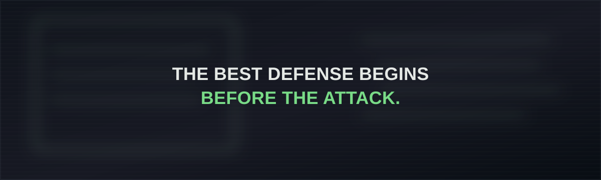

  

    

  

## Cyber Incident Archive

Explore the [100-incident catalogue](CYBER_INCIDENTS.md) and the [in-depth case studies](INCIDENT_CASE_STUDIES.md) covering attack methods, affected users and systems, business disruption, financial impact, and defensive lessons.
